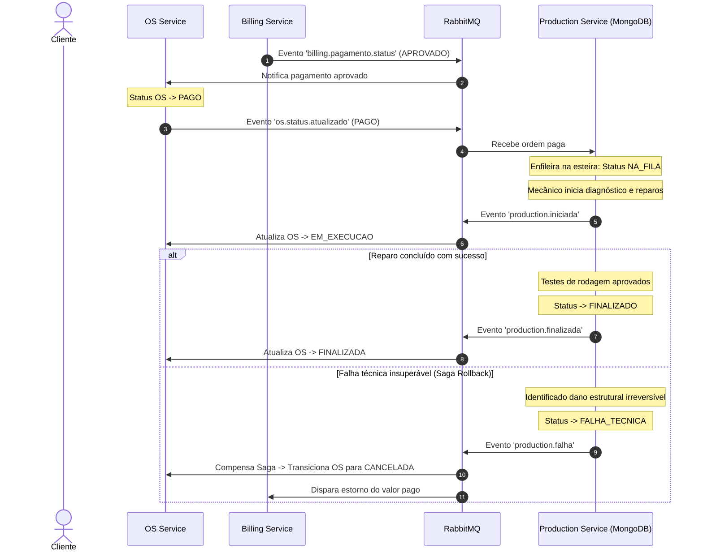

# FIAP Oficina - Microsserviço de Execução e Produção (Production Service)

[](https://github.com/marcelsenarios/fiap-oficina-production-service/actions)


Microsserviço responsável pela **gestão da esteira física e mecânica de produção da oficina**, controle da **fila de atendimento com priorização inteligente**, histórico e apontamentos técnicos (diário de bordo dos reparos veiculares), **persistência NoSQL (MongoDB)** e execução das etapas transacionais e compensatórias do **Saga Pattern** (Tech Challenge Fase 4 — Pós-Tech FIAP SOAT).

---

## 1. Responsabilidades do Serviço

- **Fila Inteligente de Produção**:
  - Ordenação prioritária com suporte aos níveis: `URGENTE`, `ALTA`, `NORMAL` e `BAIXA`.
  - Desempate cronológico (FIFO por data de entrada na fila).
- **Esteira e Ciclo de Vida Operacional**:
  - `NA_FILA` ➔ `EM_DIAGNOSTICO` ➔ `EM_EXECUCAO` ➔ `EM_TESTES` ➔ `FINALIZADO` (ou `FALHA_TECNICA` / `CANCELADO`).
- **Diário de Bordo e Apontamentos Técnicos**:
  - Registro cronológico e detalhado de cada ação mecânica, peça instalada, medições e testes de rodagem realizados.
- **Banco de Dados Não Relacional (NoSQL MongoDB)**:
  - Atendimento ao requisito obrigatório de persistência NoSQL na Fase 4.
  - Modelagem rica em documentos na coleção `ordens_producao`, encapsulando histórico de apontamentos e dados de mecânicos sem necessidade de joins relacionais caros.
- **Participação no Saga Pattern**:
  - Entrada automática na esteira mediante evento assíncrono `os.status.atualizado` (status `PAGO`).
  - Notificação assíncrona ao OS Service quando os trabalhos iniciam (`production.iniciada`) e quando o veículo fica pronto (`production.finalizada`).
  - Em caso de impedimento técnico imprevisto (ex: motor fundido, falta de componente no mercado), dispara evento `production.falha` acionando a **transação compensatória (Rollback do Saga)** no OS Service e estorno no Billing Service.

---

## 2. Tecnologias Utilizadas

- **Linguagem & Framework:** Java 21 LTS + Spring Boot 3.2.5
- **Banco de Dados Não Relacional (NoSQL):** MongoDB 7.0 (banco isolado `oficina_production_db`)
- **Mensageria:** RabbitMQ (AMQP Topic Exchanges)
- **Testes Unitários & BDD:** JUnit 5, Mockito, Cucumber BDD e JaCoCo (cobertura mínima de 80%)
- **Documentação:** SpringDoc OpenAPI 3 / Swagger UI (`/swagger-ui.html`)
- **Containerização & Deploy:** Docker multi-stage build e manifestos Kubernetes (Deployment, Service, ConfigMap, Secrets, HPA, MongoDB)

---

## 3. Papel no Saga Pattern



---

## 4. Endpoints Principais (REST API)

| Método | Endpoint | Descrição |
|---|---|---|
| `POST` | `/api/v1/producao/ordens` | Entrada manual de ordem na esteira de produção |
| `GET` | `/api/v1/producao/ordens` | Listar todas as ordens de produção ou filtrar por status |
| `GET` | `/api/v1/producao/ordens/fila` | Consultar fila ativa ordenada por prioridade e tempo de espera |
| `GET` | `/api/v1/producao/ordens/{id}` | Buscar ordem de produção por ID (MongoDB ObjectId) |
| `GET` | `/api/v1/producao/ordens/os/{osId}` | Buscar ordem de produção pelo ID da OS de origem |
| `POST` | `/api/v1/producao/ordens/{id}/diagnostico` | Iniciar diagnóstico preliminar e vincular mecânico |
| `POST` | `/api/v1/producao/ordens/{id}/execucao` | Iniciar reparos (notifica OS Service via RabbitMQ) |
| `POST` | `/api/v1/producao/ordens/{id}/testes` | Iniciar bateria de testes e validação veicular |
| `POST` | `/api/v1/producao/ordens/{id}/apontamentos` | Incluir apontamento técnico / nota da oficina |
| `POST` | `/api/v1/producao/ordens/{id}/finalizar` | Concluir ordem e liberar veículo (notifica OS Service) |
| `POST` | `/api/v1/producao/ordens/{id}/falha` | Reportar falha técnica e disparar Rollback do Saga |
| `POST` | `/api/v1/producao/ordens/{id}/cancelar` | Cancelar ordem de produção |

---

## 5. Como Executar Localmente

### Testes e Verificação de Cobertura JaCoCo (>= 80%)
```bash
./mvnw clean verify
```
- Relatório de Cobertura JaCoCo: `target/site/jacoco/index.html`
- Relatório BDD Cucumber: `target/cucumber-reports/report.html`

### Executar Aplicação Localmente
Certifique-se de que o MongoDB e o RabbitMQ estejam rodando:
```bash
./mvnw spring-boot:run
```
Documentação interativa Swagger disponível em: `http://localhost:8083/swagger-ui.html`
Actuator Health Check: `http://localhost:8083/actuator/health`

---

## 6. Manifestos Kubernetes (`/k8s`)

O diretório `k8s/` contém a especificação completa para orquestração em cluster:
- `mongodb.yaml`: Deployment e Service do banco NoSQL MongoDB com volume de dados.
- `configmap.yaml` e `secrets.yaml`: Configurações de ambiente e credenciais de infraestrutura.
- `deployment.yaml`: Deployment com 2 réplicas, health probes (`liveness` e `readiness`) e limites de CPU/memória.
- `service.yaml`: Service ClusterIP interno para comunicação entre pods.
- `hpa.yaml`: Horizontal Pod Autoscaler com escalabilidade automática baseada em consumo de CPU (70%) e memória (80%).
